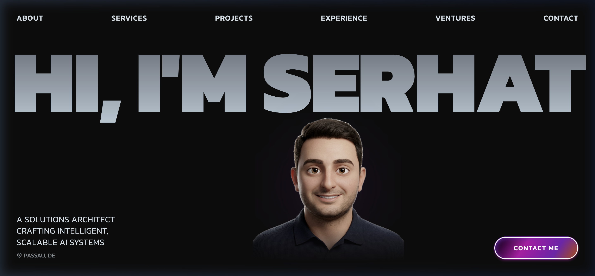
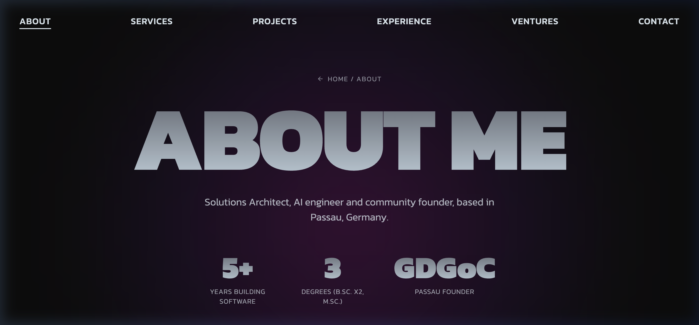
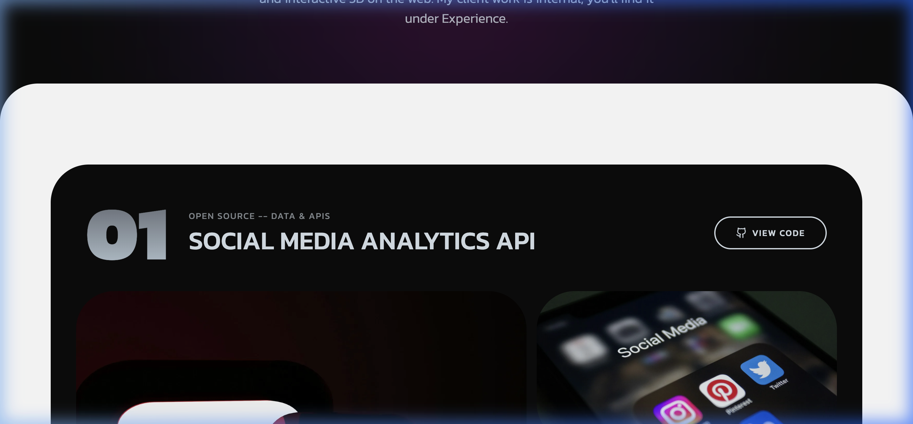
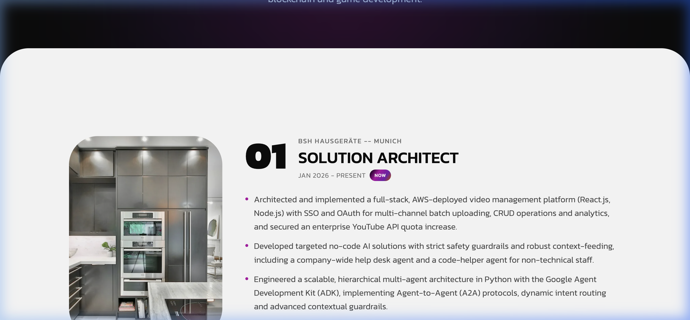
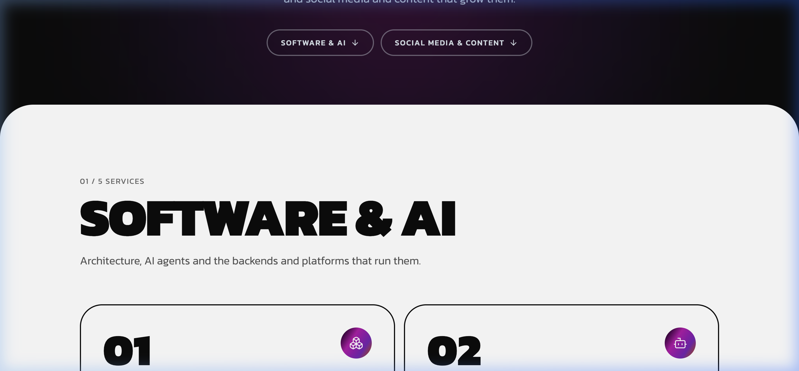
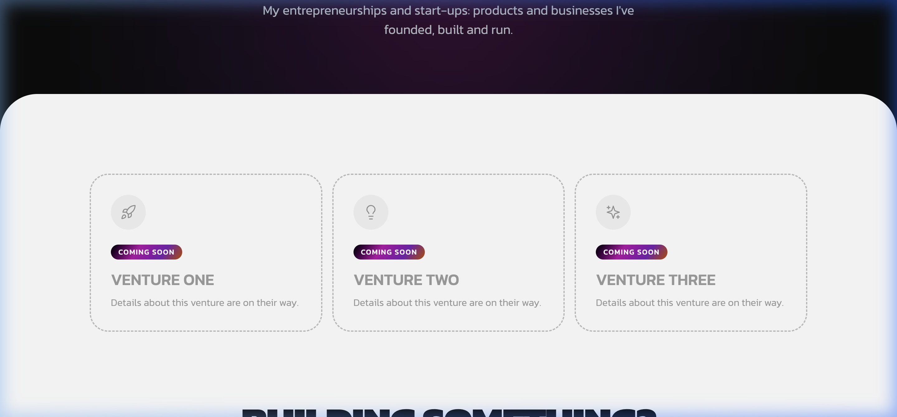

# Serhat Kumas — Solutions Architect & AI Engineer

[](https://serhatkumas.github.io/)
[](https://react.dev/)
[](https://www.typescriptlang.org/)
[](https://vitejs.dev/)
[](https://tailwindcss.com/)

> Personal portfolio and showcase of **Serhat Kumas** — Solutions Architect and AI Engineer specializing in multi-agent AI architectures, scalable backends, full-stack cloud platforms, and technical leadership based in Passau, Germany.

---

## 🌟 Live Preview

Visit the production site at **[https://serhatkumas.github.io/](https://serhatkumas.github.io/)**.



---

## 📸 Pages & Showcase

### 1. Home
Interactive hero section with custom 3D avatar, dynamic marquee, card stacking interactions, and responsive navigation.


---

### 2. About Me
Background, education, metrics (5+ years building software, 3 academic degrees, Google Developer Groups on Campus founder), and architectural philosophy.



---

### 3. Projects
Curated open-source projects featuring conversational AI, multi-agent orchestrations, data APIs, and interactive 3D web applications directly connected to GitHub stats.



---

### 4. Experience
Professional career history including Solution Architect at BSH Hausgeräte (Munich), DC Academy, and game development engineering.



---

### 5. Services
Comprehensive breakdown of consulting and engineering services spanning AI/Software Architecture, multi-agent frameworks, scalable cloud backends, and drone videography.



---

### 6. Ventures
Entrepreneurial initiatives, developer communities (GDGoC Passau), hackathons, and AI research ventures.



---

## 🛠️ Tech Stack & Architecture

- **Core Framework:** [React 18](https://react.dev/) with [TypeScript 5](https://www.typescriptlang.org/)
- **Build Tool:** [Vite 5](https://vitejs.dev/) with hot module replacement (HMR)
- **Styling:** [Tailwind CSS 3](https://tailwindcss.com/) with custom design tokens and dark palette (`#0C0C0C`)
- **Animations:** [Framer Motion](https://www.framer.com/motion/) for fluid page transitions, cards, and micro-interactions
- **Icons:** [Lucide React](https://lucide.dev/)
- **Routing:** [React Router 6](https://reactrouter.com/) with custom GitHub Pages SPA redirect fallback
- **CI/CD:** [GitHub Actions](https://github.com/features/actions) for automated zero-downtime deployment

---

## 🚀 Getting Started Locally

### Prerequisites
- Node.js (version 18+ or 20+ recommended)
- npm or pnpm

### Installation

```bash
# Clone the repository
git clone https://github.com/SerhatKumas/serhatkumas.github.io.git
cd serhatkumas.github.io

# Install dependencies
npm install

# Start the local development server
npm run dev
```

The app will be running at `http://localhost:5173/`.

### Building for Production

```bash
# Type check and compile the production bundle
npm run build

# Preview the production build locally
npm run preview
```

---

## 🚢 Deployment

The portfolio is continuously deployed to **GitHub Pages** using GitHub Actions:

- On every push to the `main` branch, [`.github/workflows/deploy.yml`](.github/workflows/deploy.yml) triggers automatically.
- It compiles the TypeScript code, bundles assets with Vite, sets up the SPA 404 fallback routing, and publishes the `dist/` directory to GitHub Pages.

---

## 📬 Contact & Connect

- **Website:** [https://serhatkumas.github.io/](https://serhatkumas.github.io/)
- **LinkedIn:** [/in/serhatkumas](https://www.linkedin.com/in/serhatkumas/)
- **Email:** [serhatkumas@outlook.com](mailto:serhatkumas@outlook.com)
- **GitHub:** [@SerhatKumas](https://github.com/SerhatKumas)
